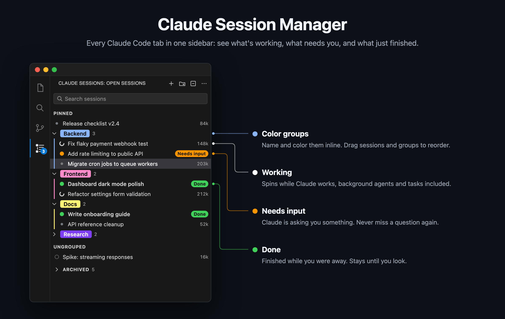

# Claude Session Manager

**Run five Claude Code sessions at once without losing track of any of them.**

A VS Code sidebar that lists every open Claude Code tab with its live status, so you can see at a glance which session is working, which one is waiting for your answer, and which one just finished. Group sessions by project with colored tags, drag them into order, pin the important ones and archive the rest.

<p align="center">
  
</p>

- **Live status**: a spinner while Claude works (background agents and tasks included), an orange **Needs input** when Claude asks you something, a green **Done** that stays until you look.
- **Color groups** like browser tab groups: 16 colors, rename and recolor inline, collapse, drag to reorder.
- **Drag and drop** sessions between groups, **Pin** to the top, **Archive** to close a tab and reopen it later in the same place.
- **Badge** on the sidebar icon counts the sessions that need you. **Search**, keyboard navigation, **Jump to session** (`Cmd+Alt+J`), **Copy Session ID**.
- **Read-only and local**: it only reads files Claude Code already writes. No hooks, no settings changes, no network.

> Personal project, not made by or affiliated with Anthropic. It reads files that Claude Code writes for its own use. They are not a public API, so a Claude Code update can break the panel. Built and tested on macOS with Claude Code 2.1.306–2.1.312.

---

## Contents

1. [Install and update](#1-install-and-update)
2. [Features (what the user sees)](#2-features-what-the-user-sees)
3. [How it is built](#3-how-it-is-built)
4. [Internal logic](#4-internal-logic)
5. [Traps already hit (read before changing things)](#5-traps-already-hit-read-before-changing-things)
6. [Develop, test, release](#6-develop-test-release)
7. [Known limits and open issues](#7-known-limits-and-open-issues)
8. [Owner decisions](#8-owner-decisions)
9. [Version history](#9-version-history)

---

## 1. Install and update

The extension is installed **per user**: once installed, it appears in every VS Code window on that machine. It has no build step and no dependencies.

**Install the latest release on any Mac** (the repo is public, so no login is needed):

```sh
curl -fsSL -o /tmp/claude-tab-groups.vsix \
  https://github.com/Mecha-Coder/Claude-Session-Manager/releases/latest/download/claude-tab-groups.vsix
code --install-extension /tmp/claude-tab-groups.vsix --force
```

Then run **Developer: Reload Window** in VS Code. Reloading restarts every running Claude Code session, so do it when none is working.

**Install from a local checkout:**

```sh
sh package.sh                                   # writes claude-tab-groups-<version>.vsix
code --install-extension claude-tab-groups-<version>.vsix --force
```

If `code` is not found, run **Shell Command: Install 'code' command in PATH** in VS Code first.

**What does not travel between machines:** groups, order, pins and the archive are saved in VS Code's per-workspace storage (`workspaceState`). A new machine or a different workspace folder starts with an empty layout.

---

## 2. Features (what the user sees)

The panel lives in its own Activity Bar icon (**Claude Sessions**) as one webview view (**Open Sessions**).

### 2.1 Status marks

Each row starts with a status mark. The status is live: it updates within about 60 ms of Claude Code changing it.

| Mark | Status id | Meaning | How to see it |
|---|---|---|---|
| Thick spinning arc, in the title's text color | `working` | Claude is working, or is idle but still has background work running (a background command or a background helper agent) | Send any prompt |
| Bright orange pulsing dot + orange **Needs input** pill | `needs-input` | Claude asked a question or is waiting for a permission approval; also an old question you never answered | Ask Claude to ask you something |
| Bright green pulsing dot + green **Done** pill + bold title | `done` | Claude finished and you have not gone back to it yet | Let a session finish |
| Small grey dot | `idle` | Idle and already seen | Open a Done session |
| Hollow circle | `stopped` | A tab that VS Code restored after a reload; its Claude process starts when you open it | Reload the window, look before opening tabs |
| Dashed circle | `unknown` | A tab not yet matched to a session: a brand-new "Claude Code" tab, or a new session in the 2–6 seconds before Claude Code gives it a title | Open a new Claude tab |
| Box icon | (archived) | A session in the Archived section | Archive a session |

- The **Needs input** and **Done** colors (`#ff9500`, `#3fd15a`) are fixed, not theme colors, so they stand out in every theme. No group color uses bright orange, green or blue, so groups never look like a status.
- **Done** stays until you switch to that tab, click its row, or the session starts working again.
- The pulsing animations stop when the OS asks for reduced motion.

### 2.2 Rows

- **Title**: the session's full title. Claude Code's own tabs cut titles to 24 characters plus "…"; the panel shows the whole title.
- **Right side**: the context size (for example `458k` = tokens in the context after Claude's last reply), replaced by the **Needs input** or **Done** pill when one applies.
- **Tooltip** (hover): title, status (with the reason, for example "input needed"), exact token count and model, and last activity ("4 min ago").
- **Hover buttons** (they replace the right side while hovering): **Pin / Unpin**, **Archive** (only for sessions with a known ID), **Close tab**.
- **Click**: goes to that tab. The row of the tab you are looking at is highlighted.
- **Activity Bar badge**: the number of sessions that need you (Needs input + Done), with a tooltip such as "1 needs your input · 2 finished".

### 2.3 Groups

- A group is a colored name chip (like a Chrome tab group), a count, and a colored line down the left of its sessions.
- **Create**: the folder icon in the panel title bar creates "New group" and opens its editor straight away.
- **Inline editor** (pencil on hover, `F2` on a focused group, or right-click → *Rename or Change Color…*): a name field (max 60 characters), 16 color swatches in two rows of 8 (light colors on top with dark text, deep colors below with white text), and **Delete group**. `Enter` saves, `Esc` cancels, clicking outside saves. A new color applies at once.
- **Colors**: Red, Pink, Purple, Indigo, Sky, Cyan, Lemon, Sand / Crimson, Berry, Violet, Navy, Slate, Teal, Grey, Brown. A new group takes the first color no other group uses.
- **Collapse**: click the group head. The title bar has *Collapse All*; the `…` menu has *Expand All*.
- **`+` on a group**: opens a new Claude Code tab that joins that group (if the tab appears within 20 seconds).
- **Delete group** never closes sessions: they move to Ungrouped.
- An empty group shows "Drag sessions here".

### 2.4 Sections

- **Pinned** (top): pinned sessions. Unpinning puts a session back in the group it came from. Hidden when empty.
- **Groups**, in the order you set.
- **Ungrouped**: everything else. Hidden when empty, except while dragging a session (it becomes a drop target).
- **Archived** (bottom, collapsed by default, with a count): sessions you archived. Click a row to reopen it; it returns to the group it was archived from. Hover buttons: *Reopen*, *Remove from archive*. Kept up to 200 entries.

### 2.5 Drag and drop

- Drag a session to reorder it, or drop it into another group, Pinned or Ungrouped. A blue line shows the exact drop position; dropping on a group head or section header puts it at the end/start of that list.
- Drag a group head to reorder groups.
- Dropping on the empty space below everything puts the session at the end of Ungrouped.
- Moves show at once (the panel updates locally, then the extension saves).
- Dragging is off while a search is active.

### 2.6 Search

- The box at the top filters sessions and archived entries by title (case-insensitive substring) and highlights the match.
- While searching, groups with no hits hide and collapsed groups open.
- `Esc` clears; `↓` moves into the list. The query survives the panel being hidden.

### 2.7 Right-click menus

| On | Items |
|---|---|
| A session | Pin to Top / Unpin · Move to Group… · Copy Session ID · Archive (Close Tab, Keep Here to Reopen) · Close Tab |
| A group head | New Claude Session in This Group · Rename or Change Color… · Close All Tabs in Group · Delete Group (Keep Tabs Open) |
| An archived row | Reopen · Remove from Archive · Copy Session ID |

- *Copy Session ID* copies the same ID that Claude Code's `/status` shows. It is hidden for tabs whose session is not known yet.
- *Move to Group…* opens a picker with a colored dot per group, plus *New group* and *No group*.
- Closing or archiving a session that is working or waiting for input asks first, because closing its tab stops it.

### 2.8 Commands and keys

| Command | Where | Key (Mac / other) |
|---|---|---|
| New Claude Session | title bar `+` | |
| New Group | title bar folder icon | |
| Collapse All Groups | title bar | |
| Expand All Groups | title bar `…` | |
| Jump to Session… (searchable list of all open sessions with status) | title bar `…`, palette | `Cmd+Alt+J` / `Ctrl+Alt+J` |
| Move Current Session to Group… | palette | `Cmd+Alt+G` / `Ctrl+Alt+G` |
| Diagnose: Show How Tabs Match Sessions | title bar `…` | |

Inside the panel: `↑`/`↓` move between rows and group heads, `Enter`/`Space` activate, `F2` edits a group, `Tab` lands on the active session.

### 2.9 Other states

- **No Claude tabs open**: "No Claude Code sessions are open." with a *New Claude session* button.
- **Warning bar** at the top: shown when Claude Code's status folder is missing or its files change shape, so the panel never shows wrong status silently.

### 2.10 Settings

| Setting | Default | Purpose |
|---|---|---|
| `claudeTabGroups.viewTypePattern` | `claudeVSCodePanel` | Case-insensitive regex matched against a webview tab's view type to decide whether it is a Claude Code tab |
| `claudeTabGroups.newSessionCommand` | `claude-vscode.editor.open` | Command the `+` buttons run |

---

## 3. How it is built

Plain JavaScript (CommonJS), no build step, no runtime dependencies, no npm install. VS Code API `^1.85.0`.

### 3.1 Files

| File | Role |
|---|---|
| `package.json` | Manifest: view container, webview view, commands, menus (`view/title`, `webview/context`, `commandPalette` hiding), keybindings, settings. Extension id `local.claude-tab-groups`. |
| `extension.js` | Extension host side. The `Panel` class: finds Claude tabs, reads live status, matches tabs to sessions, works out each row's status, keeps the layout state, posts the model to the webview, and handles every action. Also `activate()` with all command registrations. |
| `lib/sessions.js` | Reads Claude Code's files: live status files, transcripts (title, context size, unanswered question), helper-agent files, and the process list (background commands, and which sessions this window started). No VS Code dependency, so it is unit-tested. |
| `lib/match.js` | `bindTabs()`: decides which session each tab shows, from tab titles only. Pure function, unit-tested. |
| `lib/model.js` | The saved layout (groups, lists, pins, archive) and every rule that changes it. Pure functions, unit-tested. Also the 16-color `PALETTE`. |
| `media/panel.js` | The webview page: draws the model, search, inline group editor, drag and drop, keyboard, and posts user actions back. |
| `media/panel.css` | All styling. Uses VS Code theme variables, except the fixed status and group colors. |
| `media/tabs.svg` | Activity Bar icon. |
| `docs/demo.gif`, `docs/demo.png` | README demo image: the real `panel.js`/`panel.css` rendered with made-up sessions. Not packaged into the `.vsix`. |
| `docs/demo/hero.html`, `docs/demo/render.js` | The demo page (real panel code, mock data, callouts) and the script that renders `demo.png` and `demo.gif` from it. |
| `CLAUDE.md` (`AGENTS.md` links to it) | Rules for AI agents working on this repo. |
| `test/*.test.js` | `node:test` unit tests for the three `lib/` files (36 tests). |
| `package.sh` | Builds the `.vsix` by hand (a zip with the same layout `vsce` produces), because `vsce` is not needed for local installs. |

### 3.2 Two halves and how they talk

```
 VS Code tabs API ─┐
 ~/.claude/... ────┼─> extension.js (Panel.refresh) ──"model"──> media/panel.js (draws)
 process list ─────┘         ^                                        │
                             └──────── user actions (messages) ───────┘
```

The extension host owns all state and all decisions. The webview only draws the latest model and reports what the user did. To keep the UI from flickering, the webview applies some changes locally first (drag moves, collapse, rename) and the next model confirms them.

**Extension → webview messages**

| `type` | Fields |
|---|---|
| `model` | `colors` (palette `[id, name, hex][]`), `pinned` (rows), `groups` (`{id, name, color, collapsed, rows}[]`), `ungrouped` (rows), `archived` (`{key, title, at}[]`), `archivedCollapsed`, `notice` (warning text or `''`), `empty` (no Claude tabs) |
| `editGroup` | `gid`: open that group's inline editor |

A row is `{ key, title, status, waitingFor, tokens, model, activity, active, canArchive }`. `canArchive` is true when the row's key is a real session id (it also gates *Copy Session ID*).

**Webview → extension messages**

`ready` · `focus {key}` · `close {key}` · `archive {key}` · `reopen {key}` · `newSession {gid?}` · `move {key, to, before}` · `moveGroup {gid, before}` · `renameGroup {gid, name}` · `recolorGroup {gid, color}` · `toggleGroup {gid}` · `deleteGroup {gid}` · `pin {key}` · `unpin {key}` · `forget {key}` · `toggleArchived`

Right-click menu items are native VS Code menus: each element carries a `data-vscode-context` JSON (`webviewSection`: `session` / `group` / `archived`, plus `key`, `gid`, `pinned`, `canArchive`, and `preventDefaultContextMenuItems: true`). The `when` clauses in `package.json` read those fields, and the `claudeTabGroups.ctx.*` commands receive them as their argument.

### 3.3 What it reads from Claude Code (all undocumented internals)

| Source | What is used |
|---|---|
| `~/.claude/sessions/<pid>.json` (one per running Claude process) | `pid`, `sessionId`, `cwd`, `entrypoint` (`claude-vscode` for VS Code tabs), `status` (`busy` / `waiting` / `idle`), `waitingFor` (e.g. `"input needed"`), `statusUpdatedAt`, `startedAt` |
| `~/.claude/projects/<cwd with every non-alphanumeric char → "-">/<sessionId>.jsonl` (transcript) | Title: last `customTitle` (set by Claude Code's rename), else last `aiTitle`. Context size and model: last main-chain assistant line with `usage`. Whether that reply was an `AskUserQuestion`. Only the first 32 KB and last 256 KB are read. |
| `<project folder>/<sessionId>/subagents/agent-<id>.meta.json` | `requestShape` (`background` / `foreground`), `finished`, `stoppedByUser`: is a background helper agent still running |
| `ps -A -o pid=,ppid=,command=` (once per refresh) | A child of the Claude process whose command contains `/.claude/shell-snapshots/` is a shell Claude started, i.e. a running command. A Claude process whose parent is this window's extension host (`process.pid`, the process this extension runs in) is a session this window started |
| Claude Code's webview tab | View type contains `claudeVSCodePanel`; tab title = session title cut to 25 characters (see §5). A new tab is titled "Claude Code"; when you send the first prompt, the tab is titled with the prompt text until the AI title arrives 2–6 seconds later |
| Command `claude-vscode.editor.open [sessionId]` | With no argument opens a new Claude tab; with a session id shows or reopens that session |

Nothing is written into Claude Code: no hooks, no settings changes.

---

## 4. Internal logic

### 4.1 The refresh loop (`Panel.refresh`)

A refresh rebuilds everything from scratch and is cheap. It runs:

- 60 ms after any tab change, tab-group change, window focus change, setting change, or change in `~/.claude/sessions/` (`fs.watch`), debounced;
- every 10 seconds (context size and dead processes change without events);
- after every user action.

Steps:

1. **Find Claude tabs**: every tab whose input is a webview/custom editor with a matching view type, in visual order. Each `Tab` object gets a stable numeric id (a `WeakMap`).
2. **Read live sessions** from `~/.claude/sessions/*.json`. Skip dead pids (`process.kill(pid, 0)`) and half-written files. Keep the `entrypoint === 'claude-vscode'` sessions that this window started (their Claude process is a child of this extension host), wherever they are now, plus those whose `cwd` is inside a workspace folder of this window (all of them when no folder is open). A session can leave the workspace folder: `EnterWorktree` moves it to another folder, and Claude Code then moves its transcript and `subagents/` folder to that folder's project folder (`windowSessions`).
3. **Read each transcript** through `TranscriptCache` (re-read only when mtime or size changed).
4. **Restored tabs**: tab titles that match no running session are looked up in the newest 200 transcripts of the workspace's project folders (`findByTitles`). These sessions have no process, so they show as `stopped`.
5. **Match tabs to sessions** with `bindTabs` (§4.2).
6. **Give each tab a row key** (§4.3) and make sure the key has a place in the layout (`model.addKey`).
7. **Work out each status** (§4.4).
8. **Build rows**, the badge, save the layout if it changed, and post the model. A model identical to the last one posted is not sent again.

### 4.2 Matching tabs to sessions (`lib/match.js`)

VS Code gives extensions only a tab's title, so matching is by title.

- `cut(title)` reproduces Claude Code's tab title: empty → `"Claude Code"`; longer than 25 characters → first 24 + `"…"`.
- Pass 1: a titled tab takes a free session with the same cut title, preferring the session it had last time, then a running one, then the most recently updated.
- Pass 2: a tab whose title no session has yet (the transcript catches up a moment after a rename) keeps its previous session.
- There is no third pass: **a session with no title yet matches no tab.** Nothing a tab shows can prove which untitled session it holds. A new tab is titled "Claude Code", and right after your first prompt it is titled with the prompt text, which no transcript contains. Pairing by elimination ("one empty tab, one untitled session") was wrong whenever an unused "Claude Code" tab was open elsewhere, or the session ran in Claude Code's sidebar (see §5, "Session jumped to another group").
- Unmatched tabs show as `unknown`. The new session's tab is matched by title as soon as the AI title reaches the transcript, 2–6 seconds after the first prompt.

### 4.3 Row keys

- A matched tab's key is its **session id**. That is what the layout stores, so a session keeps its group across reloads.
- An unmatched tab gets a temporary key `tab:<n>` that is never saved. It keeps its last key while its session is briefly unknown, so it does not jump around.
- When a tab's key changes (temp → real, or `/clear` started a new session in the same tab), `model.renameKey` moves the new key into the old key's place.
- A session's first place is permanent: once its key has a place, a later `renameKey` never moves it. So a session must only ever be matched to its own tab, or it keeps the wrong tab's group (§5).

### 4.4 Status rules, in order

1. No matched session → `unknown`.
2. Matched session with no running process → `stopped`.
3. Running process: `busy` → `working`, `waiting` → `needs-input`, `idle` → `idle`.
4. **Background work**: an `idle` session counts as `working` when its Claude process has a child shell from `~/.claude/shell-snapshots/` (a background command), or its `subagents/` folder has a `.meta.json` with `requestShape: "background"`, no `finished`, no `stoppedByUser`, modified after the process's `startedAt`. Only idle sessions are checked. The process list comes from the one `ps` call per refresh (about 25 ms).
5. **Unanswered question**: if Claude's last main-chain reply was an `AskUserQuestion` and the status is `idle` or `stopped`, the status becomes `needs-input`. A reload can interrupt a question, yet Claude Code still shows the question form in the tab.
6. **Done (unread)**: the panel keeps an in-memory `unread` set of session ids.
   - Added when the status (after rules 1–5) goes from `working` or `needs-input` to `idle`.
   - Removed when you **arrive** at the tab (it becomes the active tab in the active editor group of a focused window, and was not last refresh), when you **click its row**, when the status becomes `working` or `needs-input`, or when the tab closes.
   - A session in `unread` shows as `done`.
   - This set is not saved: a window reload clears every Done mark.

### 4.5 The saved layout (`lib/model.js`)

Saved under the workspaceState key `claudeTabGroups.state.v2`:

```js
{
  v: 2,
  groups: [{ id, name, color, collapsed }],          // display order; color is a PALETTE id
  lists: { pinned: [key], ungrouped: [key], <gid>: [key] },  // session order per list
  pinnedFrom: { key: listId },                        // where a pinned session came from
  archived: [{ key, title, from, at }],               // newest first, max 200
  archivedCollapsed: true,
  seen: { key: dayNumber },                           // last day each session was open
  legacy: { title: gid }                              // v1 migration leftovers
}
```

- Every session key is in exactly one list. `place()` moves a key, optionally before another key.
- A session not open for 30 days loses its place (`prune`, run at startup).
- `toJSON` drops temporary `tab:` keys before saving.
- `load` migrates the first version's state (`claudeTabGroups.state.v1`, groups remembered by tab title), except the title `"Claude Code"`, which would have pulled every new tab into an old group. It also maps pre-0.3.0 theme color ids (`charts.blue` …) to the nearest palette color.

### 4.6 Actions worth knowing

- **Focus a tab**: webview tabs have no "open" API, so the panel focuses the tab's editor group (`workbench.action.focusNthEditorGroup`), then opens by index (`workbench.action.openEditorAtIndexN`).
- **Archive**: closes the tab first, then archives. If closing was cancelled, nothing is archived.
- **Reopen**: runs `claude-vscode.editor.open <sessionId>`. When the tab appears, `addKey` finds the key in the archive and restores it to its old list.
- **New session in a group**: remembers `{ gid, until: now + 20 s }`; the next Claude tab that opens joins that group.
- **Move to Group picker icons**: QuickPick icons cannot take arbitrary colors, so a small SVG dot per color is written to the extension's global storage folder.

### 4.7 Webview details

- Content Security Policy: `default-src 'none'`, styles only from the extension's `media/` folder, scripts only with a per-load nonce. Set styles from JS (`element.style.setProperty`), never as inline `style="..."` in HTML strings.
- VS Code unloads a hidden webview. The page posts `ready` when it loads; the extension then resends the full model.
- A model that arrives during a drag or while the group editor is open is held (`waiting`) and drawn when the drag or edit ends, so the list never redraws under the pointer or the cursor.
- Chip text is black or white, whichever has better contrast on the group color.
- The working spinner is an inline SVG arc (`stroke-linecap: round`, `currentColor`) rotated with CSS.

---

## 5. Traps already hit (read before changing things)

| Trap | What happened | Rule now |
|---|---|---|
| Tab title length | Assumed Claude Code cuts tab titles at 200 characters; no long-titled tab matched, so no status showed | Claude Code's webview cuts at 25: first 24 + "…" (its function `Vp1`). `cut()` copies that; 3 tests guard it |
| Drag never started | Showing the empty Pinned drop zone at `dragstart` moved the list; Chromium cancels an HTML5 drag whose page moves during `dragstart` | Change classes only in a `setTimeout` after `dragstart`, and never reveal a drop zone above the pointer |
| Archive undid itself | A refresh between "archive" and "close tab" saw the still-open tab and restored it | Close first, archive after |
| New tabs joined old groups | The first version remembered groups by title, and every new tab starts as "Claude Code" | Never migrate or remember the "Claude Code" title |
| Done missing | Done was only set when you were not looking at the tab | Set on every finish; cleared by arriving, clicking, or new work |
| Idle while still working | The status file says `idle` as soon as Claude's turn ends, even with background work running | Background command + background agent checks (§4.4 rule 4) |
| Background commands not seen | In Claude Code 2.1.308 a simple background command (e.g. `next dev`) replaces its zsh wrapper, so no `shell-snapshots` child exists. Compound ones (`cd x && y`) keep it | Accepted: long-running servers then show idle, which matches Claude waiting for you |
| Old agent files | Claude Code versions before ~2.1.30x never wrote `finished`, so 400+ old agent files look "running" | Count only `.meta.json` files modified after the process's `startedAt` |
| Session moved folders | A session ran `EnterWorktree` into a worktree folder next to the workspace folder (`/work/app` → `/work/app-feature`). Its status file's `cwd` changed, the panel kept only sessions inside the workspace folder, and its tab showed `unknown`: no spinner while it worked, ran helper agents or ran commands | A session belongs to the window whose extension host started it (parent pid), wherever its `cwd` is now. The folder rule stays too, and is the only rule without `ps`. 2 tests guard it |
| Session jumped to another group | 31 Oct 2026, up to 0.3.5: a new session started in one group showed there, then moved to another group a few seconds later, and stayed. An unused "Claude Code" tab was open in that group. On the first prompt Claude Code titled the real tab with the prompt text, so it no longer looked new; matching pass 3 then paired the only "Claude Code" tab left with the only untitled session, the wrong tab. The session took that tab's group for good (§4.3), and when its AI title arrived its real tab joined it there | A session with no title matches no tab (§4.2); its tab shows `unknown` for 2–6 seconds. A test reproduces the 31 Oct tabs and fails on 0.3.5 |
| Dull group colors | Theme color ids (`charts.*`) looked muddy and clashed with status colors | 16 fixed hex colors; no bright orange/green/blue |
| `node --test test/` | Fails on Node 25 | `node --test test/*.test.js` |

---

## 6. Develop, test, release

```sh
npm test                 # 36 unit tests, Node's built-in runner, no install needed
sh package.sh            # builds claude-tab-groups-<version>.vsix
code --install-extension claude-tab-groups-<version>.vsix --force
# then Developer: Reload Window (restarts running Claude sessions)
```

- Bump `version` in `package.json` for every install, so VS Code replaces the old copy.
- Tests cover `lib/` only. Each test says why the behavior matters; several were checked by breaking the code and watching them fail.
- UI changes are checked by loading `media/panel.js` and `media/panel.css` in a plain HTML page with a fake `acquireVsCodeApi()` and a fake `model` message, then taking Playwright screenshots in dark and light themes and driving drags and the group editor. `docs/demo/hero.html` is such a page; `node docs/demo/render.js` re-renders the README demo from it (setup in the file header).
- **Claude Sessions: Diagnose** (title bar `…`) prints how each tab was matched, and running Claude sessions not shown in this window.

**Release a new version** (makes it installable with the command in §1):

```sh
npm test
sh package.sh
cp claude-tab-groups-<version>.vsix claude-tab-groups.vsix   # stable name for the "latest" link
git tag v<version> && git push origin main --tags
gh release create v<version> claude-tab-groups.vsix --title "v<version>" --notes "<what changed>"
```

`.vsix` files are build output and are not committed.

---

## 7. Known limits and open issues

- Two open tabs with exactly the same title can show each other's status.
- Background helper agents and compound background commands are detected; a simple background command (a server) is not (see §5).
- The badge appears only after the panel has been shown once in the window, because VS Code creates the webview view lazily.
- Done marks are not saved across window reloads.
- A new session shows `unknown` (no spinner) from your first prompt until its AI title arrives, 2–6 seconds later; a new tab you have not typed in stays `unknown`. This is on purpose (§4.2).
- The panel's order does not change the editor tab order. To hide the tab strip, set `"workbench.editor.showTabs": "single"`.
- The background-command check and finding sessions that moved out of the workspace folder use `ps`, so both are off on Windows (the rest should work but is untested there).
- A tab that VS Code restored after a reload, whose session had moved out of the workspace folders, shows `unknown` instead of `stopped`: the restored-tab lookup (§4.1 step 4) searches only the workspace's project folders.
- **Not yet confirmed in daily use**: 0.3.6 (no matching of untitled sessions). It passed its tests, and the real 0.3.5 and 0.3.6 `extension.js` were run against a fake VS Code replaying the 31 Oct tabs: 0.3.5 saved the session in the wrong group, 0.3.6 in the right one. If a session still lands in the wrong group, **Diagnose** shows which session each tab was matched to; note which tabs were open when it moved.
- **Not yet confirmed in daily use**: 0.3.5 (sessions that moved folders). It passed its tests, and the real extension code run on live sessions showed a moved session as working instead of `unknown`, but nobody has yet watched a moved session in the panel itself. If one still shows no status, **Diagnose** lists it under "Running Claude sessions not shown as a tab"; then check that its Claude process's parent (`ps -o ppid= -p <pid>`, where the pid is the status file's name) is the window's extension host, the process the other sessions of that window run under.
- **Open issue**: clicking an idle restored session sometimes flashes an error notification that disappears quickly. Its text has not been captured; no error appears in the VS Code or Claude Code logs. Suspects: the editor-group/index focus commands in `focusTab`, or Claude Code starting a restored session. A possible fix is focusing bound tabs with `claude-vscode.editor.open <sessionId>` instead, but only after the error text is known.

---

## 8. Owner decisions

- **No rename in the panel.** Only Claude Code can rename the real tab; the panel shows Claude Code's titles.
- **No alerts or sounds.** Claude Code already plays a sound; `~/.claude/notify.sh` stays untouched.
- **No hooks.** Status comes only from files Claude Code already writes (hooks miss interrupts and approvals).
- Claude Code's own Sessions list also has status, groups, rename, unread and archive, but no group colors. Check it before adding a feature that duplicates it.

---

## 9. Version history

| Version | Change |
|---|---|
| 0.1.0 | Native TreeView prototype |
| 0.2.0 | Rewritten as a webview: inline group editor, colored chips, drag and drop, pins, archive, badge, context size |
| 0.2.1–0.2.2 | Fixed the 25-character title cut, drag start, unanswered questions shown as Needs input, bright status colors |
| 0.2.3 | Done appears on every finish and stays until you look |
| 0.3.0 | 16 fixed group colors, none like the status colors |
| 0.3.1 | Thick round-ended working spinner in the title color |
| 0.3.2 | Idle sessions with a background command show as working |
| 0.3.3 | Right-click → Copy Session ID |
| 0.3.4 | Idle sessions with a background helper agent show as working |
| 0.3.5 | Sessions that moved to another folder (`EnterWorktree`) keep their live status |
| 0.3.6 | A new session no longer jumps into another group: a session with no title yet is not matched to any tab |
